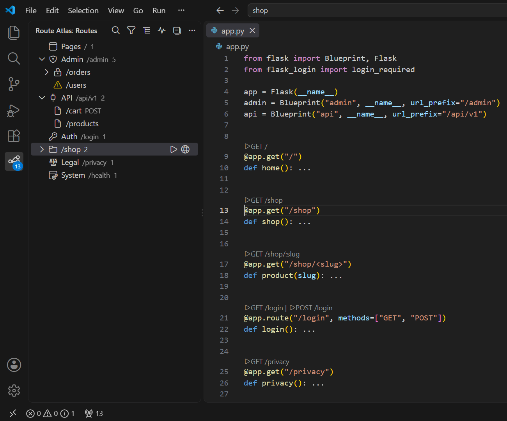

# Route Atlas

Every page and endpoint of your web project in one sorted tree, without any setup. Open a project and the routes are there.



## New in 0.3

- **Broken links, found while you type.** A link to `/abuot` or a `fetch("/api/itemz")` is underlined, and one click changes it to the route you meant.
- **Copy as cURL, fetch, Axios or HTTPie.** Right-click a route and paste a ready request into your terminal or code.
- **Typed route helpers.** `routes.usersByIdEdit({ id: 42 })` instead of hand-written strings, regenerated whenever your routes change.
- **On the command line and in CI.** `npx github:T1m0nTimon/route-atlas lint` fails the build when a link leads nowhere.

See the [changelog](CHANGELOG.md) for everything.

## Features

- **Sorted tree.** Everything below `/admin` hangs under Admin, everything below `/api` under API, down to `/users/:id/edit`. Areas for auth, account, legal and system pages are built in, and any other path that appears twice gets its own group.
- **Group it your way.** By area, path, file, framework, HTTP method or access.
- **Jump to the code.** Click a route, or press `Ctrl+Alt+R` to search all of them.
- **Follow a link.** `F12` or `Ctrl+Click` on a string like `"/admin/users"` opens its handler.
- **Send requests.** Use the play button in the tree or above the route in your code. Parameters are remembered, and the response opens next to your code.
- **Check all routes.** One click calls every plain GET route and shows the status in the tree. Routes with parameters and paths such as `/logout` or `/delete` are left out.
- **Finds your server.** Looks at `PORT` in `.env`, the framework's default port and common ports.
- **Finds problems.** Routes handled twice, and admin routes without a login check, show up in the Problems panel.
- **Finds broken links.** `href="/abuot"`, `fetch("/api/itemz")`, `router.push(...)` or `redirect(...)` that no route answers are marked in the code, with a quick fix to the route you probably meant. Works in JSX, Vue, Svelte, Astro, HTML, Jinja, PHP, Python and Markdown.
- **Copy as code.** Right-click a route and copy it as cURL, `fetch`, Axios or HTTPie, with the server address, your headers and the parameters you filled in.
- **Typed route helpers.** Generate a `routes.gen.ts` with one function per route, so `routes.usersByIdEdit({ id: 42 })` gives `/users/42/edit` and a renamed route breaks the build instead of the link. Set `routeAtlas.helpersFile` and it stays up to date.
- **Export.** Markdown, OpenAPI 3, `.http`, JSON, `sitemap.xml` and TypeScript route helpers.
- **Favorites**, a filter, and live updates when you save.

## Universal project analysis (0.4.0)

Route Atlas recognizes a broad set of language and project file families, including Python, JavaScript/TypeScript, PHP, Ruby, Java, Kotlin, C#, F#, Go, Rust, Swift, C/C++, Dart, Scala, Groovy, Elixir, Erlang, Haskell, Clojure, R, Julia, Lua, Perl, SQL, Shell, PowerShell, HTML/CSS, GraphQL, Protocol Buffers, YAML, TOML, JSON, Terraform/HCL and common project manifests.

Language recognition is extension/manifest based. Route extraction is framework-aware and is not yet a full parser for every language; unsupported route syntax is not guessed.

### Security scan

Open **Route Atlas → Security** in the left sidebar and click **Start security scan**. You can also use the scan button at the top of the Security view. The scan is local, read-only and does not execute project code. It looks for indicators such as hard-coded credentials/private keys, SQL string-concatenation risks, dynamic evaluation, unsafe shell calls, unsafe HTML insertion, disabled TLS verification, wildcard CORS, weak hashes and debug flags. Findings include file, line, CWE reference, severity and confidence, and appear in the Problems panel and project dashboard.

These checks are heuristic. They can produce false positives and cannot prove that a project is secure. Use dedicated tools such as CodeQL, Semgrep, dependency audits and secret scanners for deeper coverage. Runtime tests and active security testing are not performed automatically.

### AI security prompt

Run **Route Atlas: Create AI Security Prompt** (sparkle button in the Security view) to get a ready-to-paste Markdown prompt: what the AI should do, the attack surface, and every finding with a few lines of code. Part 1 is copied to the clipboard; a button copies the next part. Secrets, `.env` values, private keys and long tokens are replaced with `***` before anything is written.

The prompt is split into parts of at most `routeAtlas.aiPromptMaxChars` characters (default 20000, about 5000 tokens), small enough for the chat box of every common AI. Each part repeats the instructions, so it works on its own. The files are saved as `.route-atlas/ai-security-prompt.md` (and `.part-2.md`, ...), so Claude Code, Copilot or Cursor in the same project can read them directly. The folder contains a `.gitignore`, so the snippets are not committed by accident.

```bash
npx github:T1m0nTimon/route-atlas ai                      # print the prompt
npx github:T1m0nTimon/route-atlas ai . -o security.md    # write security.md, security.part-2.md, ...
```

### Route graph

Run **Route Atlas: Open Route Graph** (graph button in the Routes view) for a force-directed map of the project: every area is a hub, routes hang below their parent route, and lines lead to the source files and the security findings in them. Colors follow the areas; hover a cluster in the legend to outline it. The sidebar shows node and edge counts and has buttons for labels, force, zoom, a security heatmap and the AI prompt, plus a search. Click to select, `Shift+S` (de)selects the node under the mouse, `Shift+F` fades everything else, `Shift+R` resets, and a double-click opens the code.

Run **Route Atlas: Open Project Dashboard** for a visual summary of routes, detected languages and security indicators. After scanning, use **Route Atlas: Export Security Findings as SARIF** to create a SARIF 2.1.0 report for GitHub Code Scanning and compatible security platforms.

## Supported

- **File-based:** Next.js (app and pages), Nuxt, SvelteKit, SolidStart, Astro, Gatsby, Remix, TanStack Router
- **In code:** Flask, FastAPI, Quart, Sanic, Django, Express, Fastify, Hono, Koa, NestJS, Laravel, Rails, Spring, ASP.NET, Go, Axum, Actix, Rocket
- **Client routers:** React Router, Vue Router, Angular
- **No framework:** every HTML and PHP file

Prefixes from blueprints, routers and `app.use("/api", ...)` are followed across files. Monorepos and multi-root workspaces work.

## Command line

The same scanner works without VS Code, for scripts and CI. It needs Node.js 20 or newer and has no dependencies.

```bash
npx github:T1m0nTimon/route-atlas list            # table of all routes
npx github:T1m0nTimon/route-atlas list . --laravel-runtime  # include Laravel routes registered at runtime
npx github:T1m0nTimon/route-atlas lint            # broken links, routes handled twice, admin without login check
npx github:T1m0nTimon/route-atlas export openapi --base-url https://example.com -o openapi.json
npx github:T1m0nTimon/route-atlas export typescript -o src/routes.gen.ts
npx github:T1m0nTimon/route-atlas check --base-url http://127.0.0.1:3000
```

`list`, `lint` and `check` take `--json`. `lint` and `check` exit with 1 when they find something, so they can fail a CI job. `check` only calls plain GET routes without parameters and skips paths such as `/logout`; `--fail-on 400` also counts client errors, `--header "Authorization: Bearer ..."` adds a header. `--ignore-link <regex>` hides links that `lint` should not report. Run `route-atlas --help` for everything.

Example GitHub Actions step:

```yaml
- run: npx --yes github:T1m0nTimon/route-atlas lint
```

## Limits

By default, Route Atlas reads source code without running your application. For Laravel projects, enable the optional runtime scan with `--laravel-runtime` or the VS Code setting `routeAtlas.laravelRuntime`. It runs `php artisan route:list --json` without a shell, with a 15-second timeout, and replaces the incomplete static Laravel results with the registered routes. PHP must be available on PATH. This boots the Laravel application, so service providers and configured integrations may run; enable it only for a trusted project. If PHP is missing or Artisan fails, Route Atlas keeps the static scan. Runtime routes link to `routes/web.php` as a source fallback because Laravel does not include the defining file and line in `route:list --json`. The login check is a hint: it recognizes common decorators and middleware, not every way to protect a route. The link check only looks at addresses written as a plain string or template in known places; links pieced together with `+`, files from a `public` folder and rewrites in the server config are not checked.

### Laravel in Docker

Runtime scanning can use Docker without installing PHP on the host. Set these VS Code settings for a container named `nova-pelican-panel` whose Laravel working directory is `/var/www/html`:

```json
{
  "routeAtlas.laravelRuntime": true,
  "routeAtlas.laravelRuntimeExecutable": "docker",
  "routeAtlas.laravelRuntimeArgs": [
    "exec", "-w", "/var/www/html", "nova-pelican-panel",
    "php", "artisan", "route:list", "--json"
  ]
}
```

The command is passed as an executable plus argument array (never through a shell). Runtime-only routes open a details document showing their Laravel action and middleware; Laravel does not include the original source file and line in `route:list --json`.

## Settings

| Setting | Meaning |
| --- | --- |
| `routeAtlas.baseUrl` | Server address. Empty: detected automatically |
| `routeAtlas.requestHeaders` | Headers for every request, for example a token |
| `routeAtlas.categories` | Your own categories with `label`, `pattern` and `icon` |
| `routeAtlas.exclude` | More folders to skip |
| `routeAtlas.codeLens` | Send buttons above routes in the code |
| `routeAtlas.diagnostics` | Entries in the Problems panel |
| `routeAtlas.laravelRuntime` | Run Artisan to include dynamically registered Laravel routes (off by default; trusted projects only) |
| `routeAtlas.laravelRuntimeExecutable` | Executable for the runtime command, default `php` |
| `routeAtlas.laravelRuntimeArgs` | Arguments for the runtime command; supports Docker without a shell |
| `routeAtlas.brokenLinks` | Report links that no route answers |
| `routeAtlas.ignoreLinks` | Regular expressions for paths that are never reported, for example `^/api/` |
| `routeAtlas.helpersFile` | Keep TypeScript route helpers in this file up to date, for example `src/routes.gen.ts` |
| `routeAtlas.language` | `auto`, `en` or `de` |
| `routeAtlas.aiPromptMaxChars` | Largest size of one AI prompt part, default 20000 characters |

## Privacy

Route Atlas collects nothing and has no telemetry. Laravel runtime scanning is off by default and runs only when you enable it; it boots the project through Artisan. It only connects to the server address shown in the status bar, and only when you send a request or check routes. Port detection opens a short local connection to `127.0.0.1`.

## Development

```
npm test
npm run package
code --install-extension route-atlas-0.5.0.vsix
```
